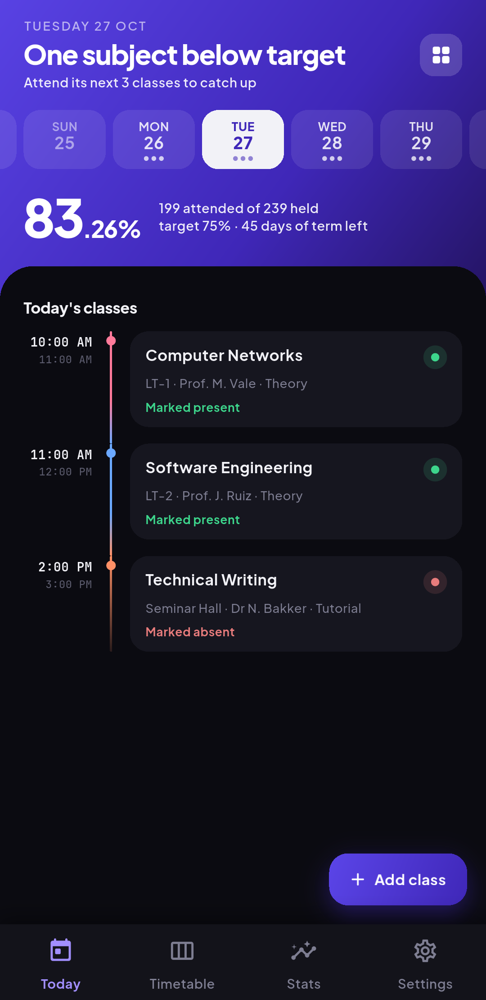
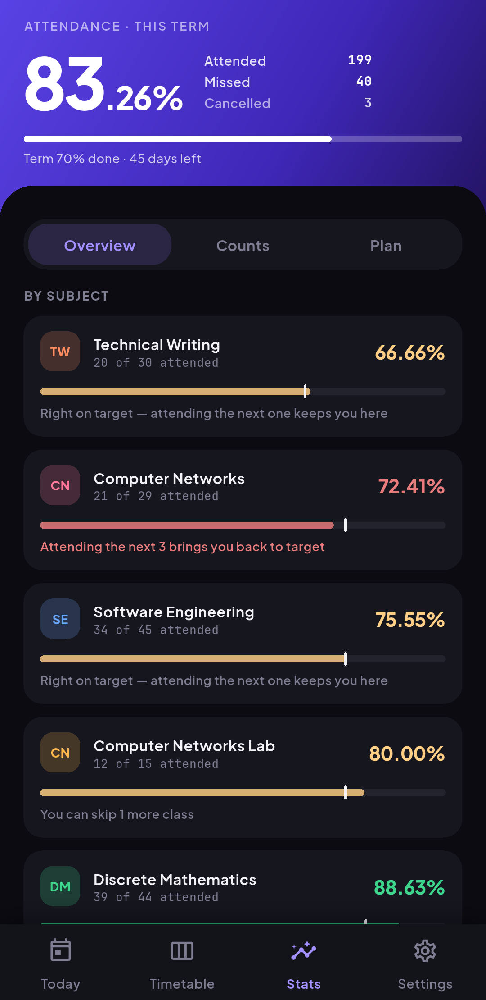
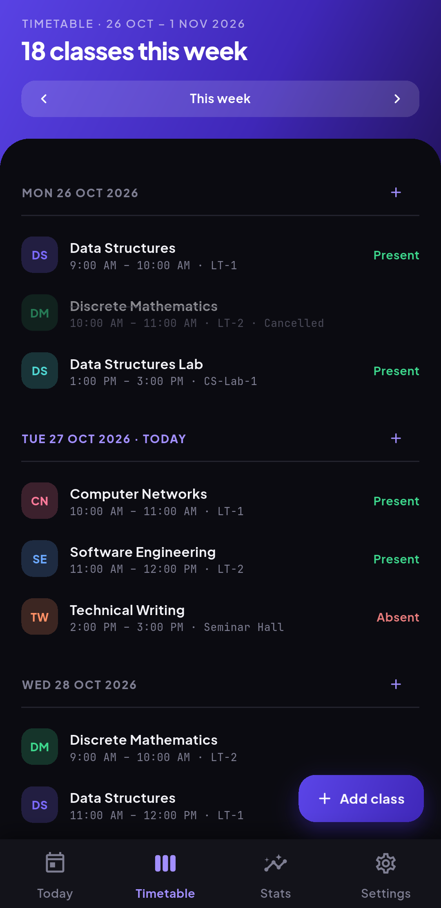
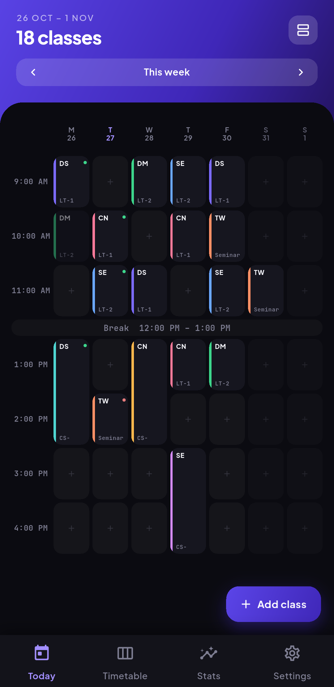
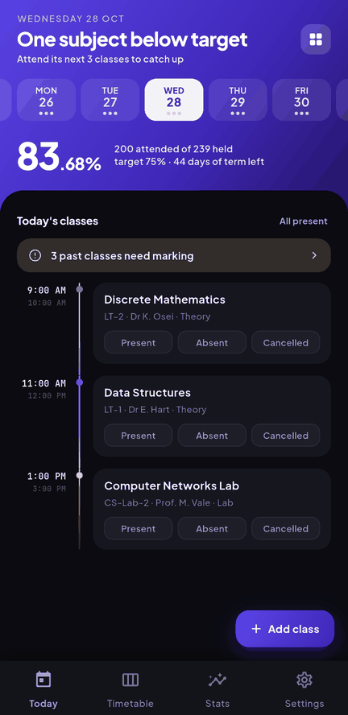
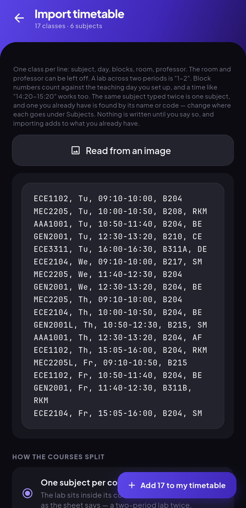
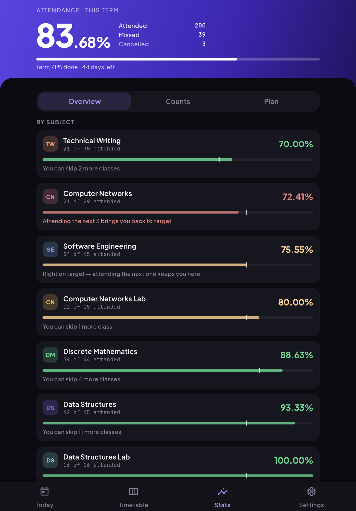
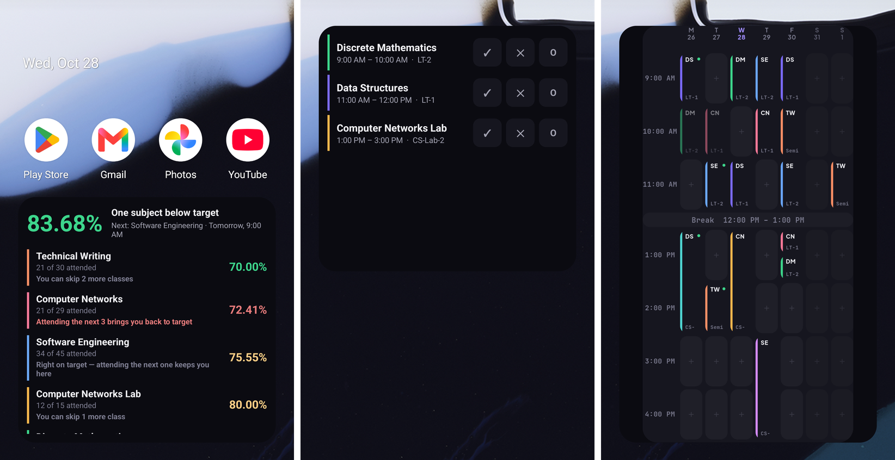
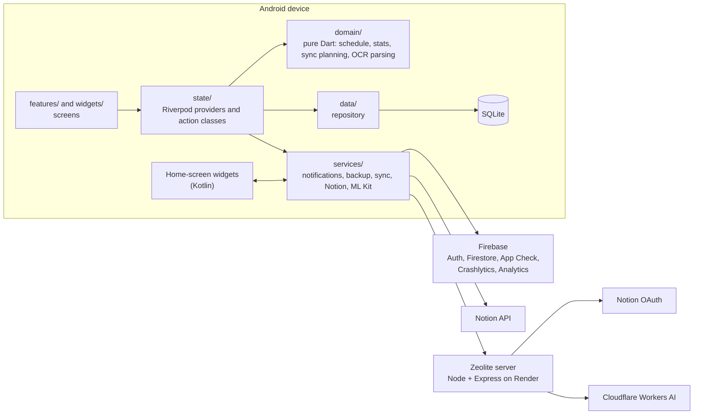

<div align="center">


# Zeolite

**Know exactly how many classes you can afford to miss.**

An Android app for tracking a university timetable and attendance. Add your
weekly schedule once, mark each class with one tap, and get a straight answer
before you skip a lecture.

[](#getting-started)
[](https://flutter.dev)
[](server/README.md)
[](LICENSE)

</div>

<p align="center">
  
  
  
  
</p>

<p align="center">
  
  
  
</p>

Your timetable and attendance live on the device, in SQLite, and everything
works with no signal. Signing in and connecting Notion are both optional and off
until you turn them on. Usage is counted on every install (screens visited and
features used, never anything you entered); [`site/privacy.html`](site/privacy.html)
is the full text.

## Features

**Marking and numbers**
- One tap for Present, Absent or Cancelled. Tapping the status a class already
  has clears it. Tags such as "Proxy" or "Online" record how a class went.
- Not just a percentage: how many classes you can still skip, how many you need
  to attend in a row to recover, and whether the target is still reachable this
  term.
- A target for the whole term (75% by default) and an override per subject.
- Stats in three views: Overview, Counts (for subjects with no timetable, or a
  balance carried over from before the app) and Plan (the term's skip budget per
  subject). *Simulate* shows what attending or missing the next few classes
  would do, without saving anything.
- An attendance log per subject, correctable in place, and Undo on deletes,
  imports and whole-day marks.

**Timetable**
- A weekly class is entered once with several weekdays ticked; one-off classes
  and single-week changes sit on top.
- The day as a grid of blocks: set when it starts and ends and how long a
  lecture runs, then fill the timetable in on the grid. A double lab is two
  blocks.
- Class types (Lecture, Practical, Tutorial or your own) with a default length
  and a weight, so a practical can count as two classes or as none.
- Holidays, term dates and saved rooms.

**Getting data in**
- Paste a timetable a line at a time, or read it off a photo or screenshot with
  on-device text recognition. Every import is shown back as the classes it
  would create before anything is written.
- When the photo read looks doubtful, the app can offer to check it with AI.
  It asks every time and never remembers a yes.
- Read your totals off a photo of the college portal's attendance page, or
  import a CSV class log or an existing Notion table.

**Outside the app**
- Home-screen widgets: mark today's classes without opening the app, see the
  week's grid, and see where every subject stands. They move to the new day at
  midnight with the app closed.

  
- Notifications before class, at the end of class with mark buttons, in the
  evening when something is unmarked, and when a subject nears its limit.
- Optional account (email and password, or Google) that syncs the term to
  another device through Firestore.
- Optional two-way Notion sync, including into a table you already keep by
  hand.
- JSON backup to a file, plus an optional daily automatic backup to a folder
  you pick once.
- Light, dark or system theme, seven accent colours and a launcher icon to
  match each.

## Tech stack

| Piece | What it does here | Why this one |
|---|---|---|
| Flutter (Dart) | The whole app | One codebase, and a test runner that covers pure logic, widgets and SQLite on the desktop. |
| Riverpod 3 | State and providers | Compile-checked dependencies and easy overrides in tests. One state pattern across the app. |
| sqflite (SQLite) | Source of truth for the timetable and marks | Offline by default; real migrations (schema v15) tested against the real engine through `sqflite_common_ffi`. |
| shared_preferences, flutter_secure_storage | Settings; the Notion token in the Android Keystore | A token belongs in the Keystore, not in plain preferences. |
| Google ML Kit text recognition | Reads timetable and portal photos | Runs on the device, so a photo of a sheet never has to leave the phone. |
| home_widget plus Kotlin | Home-screen widgets | Android can't render Flutter into a widget. Dart builds the payload; Kotlin only draws it. |
| flutter_local_notifications | Reminders and class-end actions | Exact local scheduling with no server. |
| Firebase Auth and Cloud Firestore | Optional account and sync | Security rules give per-user access without a backend of my own for data. |
| Firebase App Check, Crashlytics, Analytics | Server request checks, crash reports, usage counts | Crash reports send the error type and stack, never the message, so nothing typed in rides along. |
| Node 24 and Express 5 ([`server/`](server/README.md)) | Notion OAuth exchange and the AI timetable check | Holds the two secrets the APK can't carry. Small enough to read in one sitting. |
| Cloudflare Workers AI | The model behind the AI check | A vision model on a free tier, called only from the server. |
| Render | Hosts the server | Free tier, deploys from this repo. |

## Architecture



Rules the code keeps:
- The UI never touches SQL, and `lib/domain/` never imports Flutter, so the
  logic that matters is unit-tested without a device.
- Every change to data goes through the action classes in `lib/state/actions/`,
  which share one undo store and one refresh path.
- The phone talks to Notion directly. The server only does the OAuth exchange
  and the AI read, so it never sees attendance data.

<details>
<summary>How the numbers are worked out</summary>

A weekly class is stored as a rule, not a row per week. `ScheduleEngine` expands
rules into occurrences for whatever date range a screen asks for, removes
holidays and anything outside the term, then adds one-off classes and attaches
marks. Dates are `yyyymmdd` integers and times are minutes since midnight, so
neither drifts with timezones. A mark is keyed by subject, date and start time,
so it survives an edit to the class that made it.

With `p` classes attended out of `h` held and a target `t`
(`lib/domain/attendance_stats.dart`):

- **Percentage:** `p / h`, with cancelled classes left out of both sides by
  default.
- **Can skip:** `⌊p / t⌋ − h`, never below zero
- **Must attend:** `⌈(t·h − p) / (1 − t)⌉`, never below zero

</details>

Backend details, endpoints and environment variables are in
[`server/README.md`](server/README.md).

## How I built it

I wanted somewhere to update my own attendance every day and check it against
my college portal, which can take a while to catch up. I wasn't keeping any
record of my own before this.

- **August 2026.** The first commit was *Attend It!*: a simple app for marking
  attendance, with a darker, older look and little of the structure it has
  now. Over the next ten days I added the block grid, renamed it Zeolite,
  moved every screen onto a new design, and added tags, holidays, file backups,
  a pasted timetable import and reading a timetable off a screenshot. By the
  end of the month it had sign-in with Firestore sync, the server for the
  Notion handshake, and the first Notion sync.
- **September 2026.** As it kept growing, I decided to make it a full app I
  could ship. Home-screen widgets, the AI check for doubtful sheets, and
  claiming rows in a Notion table someone already keeps by hand. Four friends
  suggested features and lent me their timetables, which turned a parser for
  one college's sheets into one that reads other layouts. Mid-month I split the
  large classes (the class editor, settings, sync and actions) into smaller
  pieces.
- **October 2026.** Review passes over the app, the server and security, then a
  dependency and secrets audit, and fixes for what they found. Crashlytics, a
  term skip budget, a Maestro regression suite against the Firebase emulators,
  and a device pass on a tablet and a phone, which found the widget bugs
  below.

## Challenges

<details open>
<summary><b>Widget marks going stale</b></summary>

- **Problem:** a mark made on the home-screen widget was saved, but the app (and
  sometimes the widget) went on showing the old state until the app was closed
  and opened again.
- **Cause:** a widget tap is handled in a background Dart isolate. The app only
  checked for widget writes when it resumed, so if the write landed after that
  check, nothing told the app to reload.
- **Fix:** the background handler announces each write to the running app over
  a port registered with `IsolateNameServer`, and the app reloads on every
  announcement as well as on resume, so the last write wins
  (`lib/state/home_widget_providers.dart`, [`0cb2df0`](https://github.com/SoumoparnoRoy/Zeolite/commit/0cb2df0)).
- **Result:** reproduced on a tablet before the fix, and covered by
  `test/widget_mark_watcher_test.dart`, including a write that lands before the
  app's first look.

</details>

<details>
<summary><b>Every widget tap logged as a fatal crash</b></summary>

- **Problem:** with the app open, each widget link (`zeolite://open?tab=…`)
  switched tabs correctly but also raised "Could not find a generator for
  route".
- **Cause:** Flutter's built-in deep linking was on, so Android handed the link
  to the navigator as a named route the app doesn't define. The crash handler
  counts framework errors as fatal, so in release every widget tap would have
  shown up as a crash.
- **Fix:** turn off `flutter_deeplinking_enabled` on `MainActivity`, so links
  arrive only through `home_widget` and `app_links`, which already handled them
  ([`8340cb0`](https://github.com/SoumoparnoRoy/Zeolite/commit/8340cb0)).
- **Result:** the links still open the right tab, and the error is gone.

</details>

<details>
<summary><b>Reading a timetable off a photo</b></summary>

- **Problem:** timetables come as grids with merged cells, rooms written under
  the class, break columns and sheets turned on their side, and each college
  lays them out differently.
- **Cause:** text recognition gives words and boxes, not a table. Reading the
  table from text positions alone put rooms in the period below and dropped
  merged cells.
- **Fix:** take structure from pixels and meaning from text. `GridLines`
  finds the table's ruled lines and merged cells; the parser treats whichever
  axis has clock times as periods and whichever has weekday names as days, so a
  transposed sheet reads the same way. A doubtful header is read again
  magnified, and the better of two reads is kept
  (`lib/domain/timetable_ocr.dart`, `lib/domain/grid_lines.dart`,
  [`14c41d5`](https://github.com/SoumoparnoRoy/Zeolite/commit/14c41d5), [`15c2156`](https://github.com/SoumoparnoRoy/Zeolite/commit/15c2156)). For a
  sheet the parser doubts, the app offers an AI check, but the parser wins every
  disagreement and the model can only fill cells the parser left empty
  (`lib/domain/vision_merge.dart`). A page-wide check once let it invent
  classes in empty periods, so it is checked cell by cell.
- **Result:** measured on a tablet, a class-wise sheet read 21 of 21 classes
  and a packed division sheet 72 of 72, both with no AI help. On the sheets I
  measured, the AI check added nothing, so it stays a safety net for a sheet
  the device can't read.

</details>

<details>
<summary><b>Duplicate rows in a hand-kept Notion table</b></summary>

- **Problem:** a friend already kept attendance in a Notion table built by
  hand. Syncing into it filed every class a second time, and copied a Courses
  table that already existed.
- **Cause:** sync matched rows by a Zeolite ID column. Rows written by hand had
  no ID, so to the app they didn't exist.
- **Fix:** before writing, pair unkeyed rows with marks that aren't linked yet
  (same subject, day, time, status and order). A pair that agrees gets only its
  ID written; one that disagrees goes to a review screen. An existing Courses
  page with the same name is taken over instead of copied, and its owner's
  values win (`lib/domain/notion/notion_claim.dart`,
  `lib/domain/sync/sync_moves.dart`, [`5914725`](https://github.com/SoumoparnoRoy/Zeolite/commit/5914725),
  [`6f7d28d`](https://github.com/SoumoparnoRoy/Zeolite/commit/6f7d28d), [`bc0d4cd`](https://github.com/SoumoparnoRoy/Zeolite/commit/bc0d4cd)).
- **Result:** on a copy of that table, a full import and sync claimed all 190
  existing rows in place with nothing filed twice. Covered by
  `test/notion_claim_test.dart` and `test/on_device_claim_test.dart`.

</details>

## Testing and quality

Numbers from runs on 27 October 2026:

| Check | Result |
|---|---|
| `flutter test` | 1186 tests, all passing |
| `flutter analyze` (`flutter_lints`, extra rules, strict casts and inference) | No issues |
| Server `npm test` | 57 tests, all passing |
| Server `npm run lint` and `npm run format:check` | Clean |
| Firestore rules tests (`firestore-test/`, on the emulator) | 14 tests, all passing |

- **Covered:** the schedule engine and the stats formulas, database migrations
  from v2 to v15 on real SQLite, sync planning and conflict handling, the Notion
  mapping round trip and row claiming, the OCR parsers, the notification rules,
  the widget payload, and widget tests for things like a double tap through a
  closing dialog.
- **Regression flows:** seven Maestro flows in `.maestro/` (marking, creating
  and deleting a subject, account sync and deletion, and the double-tap cases)
  run against the Firebase emulators on a device. They weren't part of the runs
  above.
- **Security:** Firestore rules require a verified email to create or change
  data, and cap field sizes. The server accepts each App Check token once and rate-limits per
  route. The Notion callback is bound to the browser that started it. Android
  dependencies are locked in `android/app/gradle.lockfile`.
- **No CI yet:** the checks above are run by hand before each commit.

## Getting started

**Prerequisites:** Flutter 3.47.8 or newer, an Android device or emulator, and
your own Firebase project.

1. Clone and fetch packages:
   ```bash
   git clone https://github.com/SoumoparnoRoy/Zeolite.git
   cd Zeolite
   flutter pub get
   ```
2. Add `android/app/google-services.json` from your own Firebase project with an
   Android app for `com.soumoparno.zeolite`. It's gitignored, and the Gradle
   build won't configure without it.
3. Run it:
   ```bash
   flutter run
   ```

Optional build flags:
- `--dart-define=ZEOLITE_SERVER=http://10.0.2.2:8080` points the app at a local
  server instead of the deployed one.
- `--dart-define=ZEOLITE_FIREBASE_EMULATOR=localhost` uses the Firebase Auth and
  Firestore emulators (debug builds only).

Tests and checks:
```bash
flutter analyze
flutter test
```

The rules tests need the Firebase CLI:
```bash
cd firestore-test
npm install
npm test
```

If the `android/` folder falls out of step with your Flutter version,
`tool/bootstrap.ps1` regenerates it and reapplies the two changes
`flutter_local_notifications` needs:
```powershell
powershell -ExecutionPolicy Bypass -File tool\bootstrap.ps1
```

To run the server locally, see [`server/README.md`](server/README.md).

## Project structure

| Path | What's there |
|---|---|
| `lib/` | The app: `core/`, `data/`, `domain/`, `services/`, `state/`, `features/` (one folder per screen), `widgets/` |
| `android/` | Android project, including the Kotlin home-screen widgets |
| `test/` | Unit and widget tests |
| `server/` | Node and Express service for the Notion OAuth exchange and the AI check |
| `firestore-test/` | Tests for `firestore.rules` on the Firestore emulator |
| `.maestro/` | Regression flows run on a device |
| `site/` | Privacy policy, terms and the account-deletion page (Firebase Hosting) |
| `assets/` | Bundled fonts and launcher icons |
| `tool/` | `bootstrap.ps1` for regenerating `android/` |

## Roadmap

- [ ] Alternate-week classes
- [ ] A way to restore a single class you skipped for one week
- [ ] Per-class notes and a calendar heatmap of attendance over the term
- [ ] Shareable timetable file (subjects and classes only)
- [ ] Quick-mark buttons on the before-class notification

## What I learnt

I learnt a lot between the first commit and now, and I wouldn't do it
differently. That path is what got me here, and nobody starts out knowing
everything. You keep moving forward and learn as you go.

## Credits

Built by me. Four friends suggested features and lent their timetables for
testing, which is what made the timetable reader work beyond my own college.

## License

Released under the [MIT License](LICENSE). © 2026 Soumoparno Roy.

## Contact

- Email: [soumoparnoroy2006@gmail.com](mailto:soumoparnoroy2006@gmail.com)
- LinkedIn: [linkedin.com/in/soumoparnoroy](https://www.linkedin.com/in/soumoparnoroy/)
- GitHub: [SoumoparnoRoy](https://github.com/SoumoparnoRoy)
- App support: [zeolite.help@gmail.com](mailto:zeolite.help@gmail.com)
