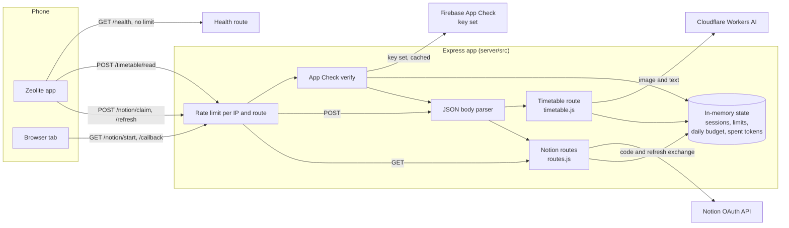
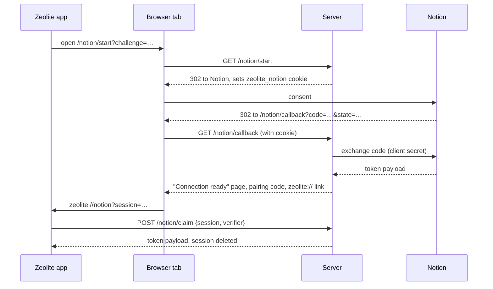

# Zeolite Server

The small Node service behind [Zeolite](../README.md). It holds the two secrets
the app can't ship inside its APK: the Notion client secret for the OAuth
handshake, and the Cloudflare token used to read a timetable off an image.

> If this service is down, Zeolite works exactly as it always does and nothing
> is lost. Syncing pauses and resumes on its own, and reading a timetable off
> an image falls back to doing it on the device.

- Node 24, Express 5, and `jose` for App Check tokens. No database.
- Runs on Render, at `https://zeolite.onrender.com`.
- Not a public API. Only the Zeolite app and the phone's browser during
  Connect Notion call it. It never sees attendance data.

## What it does

**Connect Notion.** The app makes a PKCE verifier and opens `/notion/start` in
a browser tab with its challenge. The service sends the person to Notion's
consent page, takes the code back on `/notion/callback`, exchanges it for a
token, and holds the result for up to five minutes. The app then claims it
with the verifier, either through the `zeolite://notion?session=…` link or by
typing the 8-character code shown on the page. Later, the app calls
`/notion/refresh` when its token runs out.

**Check with AI.** After reading a timetable image on the device, the app can
offer to check the read with AI. Only if the student agrees does it send a
narrowed copy of the image, along with the text it already recognised, to
`/timetable/read`. The service passes both to a Llama 3.2 vision model on
Cloudflare Workers AI and returns the classes it found (subject, weekday, room,
and times or column numbers). The app places those on its own grid, keeps only
the ones the device also read in that cell, and uses them to fill gaps in its
own read.

**Wake-up.** The app calls `/health` when the Notion settings page opens, when
*Notion sync* is tapped, and when the connect screen opens, so a free instance
that has spun down is awake before anyone taps Connect.

## Architecture



Every route runs its rate limit before it reads a body, so a caller who has
already been refused costs nothing to turn away. `/timetable/read` also checks
App Check before the body and before the daily budget, so a caller that isn't
the app can't make the service buffer a 6 MB body or spend the budget.

<details>
<summary>Connect Notion, step by step</summary>



The session id travels in a custom-scheme link that any Android app could
register for, so it's treated as intercepted: the token is released only
against the verifier, which never leaves the phone that started.

</details>

| File | What it holds |
| --- | --- |
| `src/index.js` | Config from the environment, app wiring, 404 and error handlers, start-up and shutdown |
| `src/routes.js` | The four `/notion` routes and the callback pages |
| `src/oauth.js` | Notion token exchange and refresh |
| `src/sessions.js` | Pending handshakes, in memory |
| `src/timetable.js` | `/timetable/read`: input checks and the upstream status mapping |
| `src/vision.js` | The Workers AI request and the prompt |
| `src/reply.js` | Turns the model's reply, JSON or a markdown list, into classes |
| `src/appcheck.js` | App Check token verification and single use |
| `src/limit.js` | Per-IP, per-route rate limiter |
| `src/budget.js` | The day's cap on Workers AI calls |
| `src/failure.js` | How an error reads in a log line |

## Endpoints

All rate limits are per IP per route, in a fixed one-minute window. Errors are
JSON (`{"error": "…"}`) except on the two browser routes, which answer with an
HTML page.

| Method | Path | Auth | Limit | Purpose | Status codes |
| --- | --- | --- | --- | --- | --- |
| `GET` | `/health` | none | none | Wake-up and health check, returns `ok` | `200` |
| `GET` | `/notion/start?challenge=` | none | 10/min | Starts a handshake for a 43-character base64url PKCE challenge and redirects to Notion | `302`, `400` bad challenge, `429`, `503` session store full |
| `GET` | `/notion/callback` | `state` plus the `zeolite_notion` cookie from `/start` | 30/min | Exchanges Notion's code and shows the ready page with the pairing code | `200`, `400` cancelled, expired or another browser, `429`, `502` Notion failed |
| `POST` | `/notion/claim` | PKCE verifier | 20/min | Body `{session, verifier}` or `{code, verifier}`; returns Notion's token payload once | `200`, `400`, `413`, `429` |
| `POST` | `/notion/refresh` | the refresh token itself | 10/min | Body `{refresh_token}`; returns a fresh token payload | `200`, `400`, `413`, `429`, `502` Notion failed |
| `POST` | `/timetable/read` | App Check token in `X-Firebase-AppCheck` | 3/min | Body `{image, text?}`: base64 PNG or JPEG up to 3 MB, plus the device's recognised text; returns `{classes: […]}` | `200`, `400`, `401`, `413`, `429`, `502`, `503`, `504` |

Anything else answers `404` with `{"error": "Not found."}`.

<details>
<summary>What each <code>/timetable/read</code> code means</summary>

Checked in this order:

| Code | When |
| --- | --- |
| `429` "Too many requests." | More than 3 reads from this IP in the minute |
| `503` | Image reading isn't configured (see the Cloudflare variables below) |
| `401` | No App Check token, an invalid one, or one already used |
| `413` | Body over 6 MB |
| `400` | Not JSON, no image, not base64, empty, over 3 MB decoded, or not PNG or JPEG by its bytes |
| `429` "Today's image reading has been used up…" | The day's `AI_DAILY_CALLS` are spent, or Cloudflare's own daily quota is |
| `503` | Cloudflare refused the token (401 or 403 upstream) |
| `504` | The model took longer than 110 s |
| `502` | Any other upstream failure, or a reply with no readable timetable |

The app waits 120 s, so the 110 s cut-off gets it the server's answer rather
than a timeout of its own. Each class comes back as `{subject, weekday, room,
from, to}`, with `from` and `to` in minutes after midnight, or with
`first`/`last` column numbers in place of the times when that's what the model
gave.

</details>

## Data model

There is no database. Everything below lives in the process's memory and is
gone on a restart or deploy, which is why the service runs as a **single
instance** and must not be scaled out or moved to serverless.

| Store | Key | Holds | Lifetime |
| --- | --- | --- | --- |
| Sessions (`sessions.js`) | id, OAuth `state` and pairing code, three maps to one record | `challenge`, a browser secret for the cookie, `status` (`pending` or `ready`), and the token payload once ready | 5 minutes from `/start`, deleted on claim; at most 5000 at once |
| Rate limits (`limit.js`) | `route:ip` | count and window start | one minute |
| Daily budget (`budget.js`) | UTC day | Workers AI calls made today | resets at 00:00 UTC, matching Workers AI |
| Spent App Check tokens (`appcheck.js`) | SHA-256 of the token's signed part | the token's expiry | until the token would have expired |

Session ids, states and browser secrets are 32 random bytes each. Pairing codes
are 8 characters from an alphabet without `0`, `1`, `I`, `L` and `O`, and are
read case-insensitively.

Expired entries are swept once a minute, and sessions are also checked for
expiry on every lookup, so a late sweep can't extend one.

## Environment variables

The names are in [`.env.example`](.env.example). The service refuses to start
without the three required ones.

| Name | Required | Default | Purpose |
| --- | --- | --- | --- |
| `NOTION_CLIENT_ID` | yes | | Notion public integration's OAuth client ID |
| `NOTION_CLIENT_SECRET` | yes | | Its client secret |
| `REDIRECT_URI` | yes | | This service's `/notion/callback` URL, exactly as registered with Notion. An `https` URL also makes the browser cookie `Secure`. |
| `PORT` | no | `8080` | Port to listen on |
| `APP_SCHEME` | no | `zeolite` | URL scheme of the link back to the app |
| `TRUST_PROXY` | no | `0` | Number of proxies in front. Set `1` behind a single load balancer, or every caller shares the balancer's rate-limit bucket. |
| `CLOUDFLARE_ACCOUNT_ID` | for image reading | | Workers AI account |
| `CLOUDFLARE_API_TOKEN` | for image reading | | Workers AI token |
| `FIREBASE_PROJECT_NUMBER` | for image reading | | The Firebase project App Check tokens are checked against |
| `CLOUDFLARE_MODEL` | no | `@cf/meta/llama-3.2-11b-vision-instruct` | Workers AI model |
| `AI_DAILY_CALLS` | no | `180` | Cap on Workers AI calls per UTC day |
| `NODE_ENV` | no | | Set `production` where it's deployed. Express reads it; the service's own code doesn't. |

Image reading is on only when all three of `CLOUDFLARE_ACCOUNT_ID`,
`CLOUDFLARE_API_TOKEN` and `FIREBASE_PROJECT_NUMBER` are set. Leave out all
three and `/timetable/read` answers `503` while the Notion routes run as usual.
Leave out only some and it's off too, and the start-up log names the missing
ones. The project number is required alongside the token so that a deployment
which forgot App Check stays off rather than open to anyone with the URL.

`TRUST_PROXY` and `AI_DAILY_CALLS` must be whole numbers of 0 or more. A typo
stops the service at start-up with the variable's name, and a blank value
counts as unset.

The default of 180 calls keeps the day under Workers AI's free allocation of
10,000 neurons, since a read costs roughly fifty. On the free plan Workers AI
stops at its ceiling rather than billing.

## Running locally

Needs Node 24 (`engines` in `package.json`).

```bash
cd server
npm install
```

To start it with placeholder values (enough for `/health`, the 404 and error
paths, and `/notion/start`, which redirects to Notion without calling it):

```bash
NOTION_CLIENT_ID=placeholder NOTION_CLIENT_SECRET=placeholder REDIRECT_URI=http://localhost:8080/notion/callback npm start
```

```bash
curl http://localhost:8080/health
```

To run it against the real upstreams, put the values in `server/.env`, which
is gitignored, and use `npm run dev`. Node reads the file itself
(`--env-file`), so there's no dependency for it.

To point a debug build of the app at a local server, build it with
`--dart-define=ZEOLITE_SERVER=http://10.0.2.2:8080` on the Android emulator, or
`http://localhost:8080` on a device with `adb reverse tcp:8080 tcp:8080`.

### Tests and lint

```bash
npm test              # node --test, 57 tests
npm run lint          # ESLint
npm run format:check  # Prettier; npm run format fixes it
```

The tests set their own placeholder environment and stub `fetch`, the clock
and the App Check key set, so they never reach Notion, Cloudflare or Google.
They cover the handshake (`handshake.test.js`), the timetable route, App Check
and the reply parser (`timetable.test.js`), and the limits and edges of each
route (`boundaries.test.js`).

## Security

What the code does today:

- **Secrets stay here.** The Notion client secret and the Cloudflare token are
  read from the environment and never sent to the app.
- **Notion handshake.**
  - PKCE: the token is released only to a caller holding the verifier for the
    session's challenge, compared in constant time.
  - The callback and its ready page belong to the browser that started: an
    `HttpOnly`, `SameSite=Lax` cookie scoped to `/notion`, `Secure` over https.
  - A claim deletes the session before it replies, so a token can be claimed
    once.
  - Sessions expire after five minutes, and the store is capped at 5000.
  - Once the token is in, a reload of the ready page doesn't exchange the code
    again. A callback that loses a race with another shows the ready page
    rather than an error.
- **App Check on `/timetable/read`.**
  - RS256 tokens are checked against Firebase's key set for this project's
    issuer and audience. `jose` caches the key set and refetches it only for
    an unknown key id, so a flood of forged tokens doesn't become a flood of
    requests to Google.
  - Each token is accepted once. The app asks for a limited-use token per
    read.
  - The Notion routes don't check App Check yet. They will once the app is on
    Google Play and App Check enforcement is turned on.
- **Limits.** Per-IP rate limits on every route except `/health`, the daily
  Workers AI cap, and body limits: Express's default 100 KB on the Notion
  routes, 6 MB on `/timetable/read`, and 3 MB for the decoded image. The
  recognised text is cut to 20,000 characters.
- **Input checks.** The challenge must match its format, and the image type is
  read from its bytes rather than taken from the caller.
- **Headers.** `X-Powered-By` is off, and the callback pages send
  `Content-Security-Policy: default-src 'none'; style-src 'unsafe-inline'; frame-ancestors 'none'`.
  No CORS headers are set, so a script on another site can't read a response.
- **Errors and logs.**
  - Callers get a fixed message, never a stack trace or an upstream body.
  - Logs carry status codes, error names and network causes only. No token,
    request body or model reply is logged, because a parse error would quote
    the body, which on `/notion/refresh` is a refresh token.
- **Nothing kept.** No token is held after a claim, and no image or text after
  the reply.

## Deployment

It runs as a Render web service, deployed from this repo:

| Setting | Value |
| --- | --- |
| Plan and region | Free, Singapore, one instance |
| Root directory | `server` |
| Build command | `npm install` |
| Start command | `npm start` |
| Health check path | `/health` |
| Auto-deploy | On commits to `main` that touch `server/**` |
| Node version | From `engines` (`24.x`) |

Set the variables in Render's dashboard: the three required ones,
`TRUST_PROXY=1` (Render puts one load balancer in front), `NODE_ENV=production`,
and the three image-reading ones. `REDIRECT_URI` is the service's own
`/notion/callback` URL, and must match the redirect URI on the Notion
integration.

A free instance spins down when idle, and the first request after that waits
for it to start. That's why the app calls `/health` on the way to the connect
screen.

On a deploy, Render sends `SIGTERM` and waits 30 seconds. The service stops
taking connections and gives a read already with the model up to 30 s to
finish. A handshake waiting to be claimed is lost, and the person connects
again.

## Errors and status codes

| Code | Meaning here |
| --- | --- |
| `400` | Bad input, or a body that isn't valid JSON. On the callback, the session is cancelled, expired, or belongs to another browser. |
| `401` | `/timetable/read` without a valid, unused App Check token |
| `404` | No such route |
| `413` | Body over the route's limit |
| `429` | Rate limit, or the day's image reads used up |
| `502` | Notion or Workers AI failed, or sent something unusable |
| `503` | Image reading not configured or refused by Cloudflare, or the session store is full |
| `504` | The model ran out of time |
| `500` | Anything unexpected; the body is still `{"error": "Invalid request."}` |

## Troubleshooting

| Symptom | Cause |
| --- | --- |
| `Missing required environment variables: …` at start | One of the three Notion variables isn't set. `npm start` doesn't read `.env`; `npm run dev` does. |
| `Cannot listen on port 8080: EADDRINUSE` | Something else has the port. Set `PORT`. |
| `TRUST_PROXY must be a whole number, got "…"` | A typo in `TRUST_PROXY` or `AI_DAILY_CALLS` |
| `Image reading is off, missing: …` | Only some of the three image-reading variables are set |
| Everyone gets `429` at once behind a proxy | `TRUST_PROXY` is `0`, so every caller shares the proxy's address |
| `/timetable/read` always `401` | No token, a token for another project (logged as `App Check not verified` with a claim error, which means a wrong `FIREBASE_PROJECT_NUMBER`), or a token used twice (logged as `App Check token used twice`) |
| Callback says the link expired | More than five minutes passed, the server restarted, or the callback opened in a different browser from `/start` |
| A successful connect or read shows nothing in the log | Expected. Routes log only failures. |

## What this service must never become

- It stores no users.
- It keeps no database.
- It holds no token after a claim.
- It keeps no image, and no text read off one, after the reply.
- It proxies no Notion API calls.
- It logs no tokens.

## License

MIT, as the rest of the repo. See [`LICENSE`](../LICENSE).
